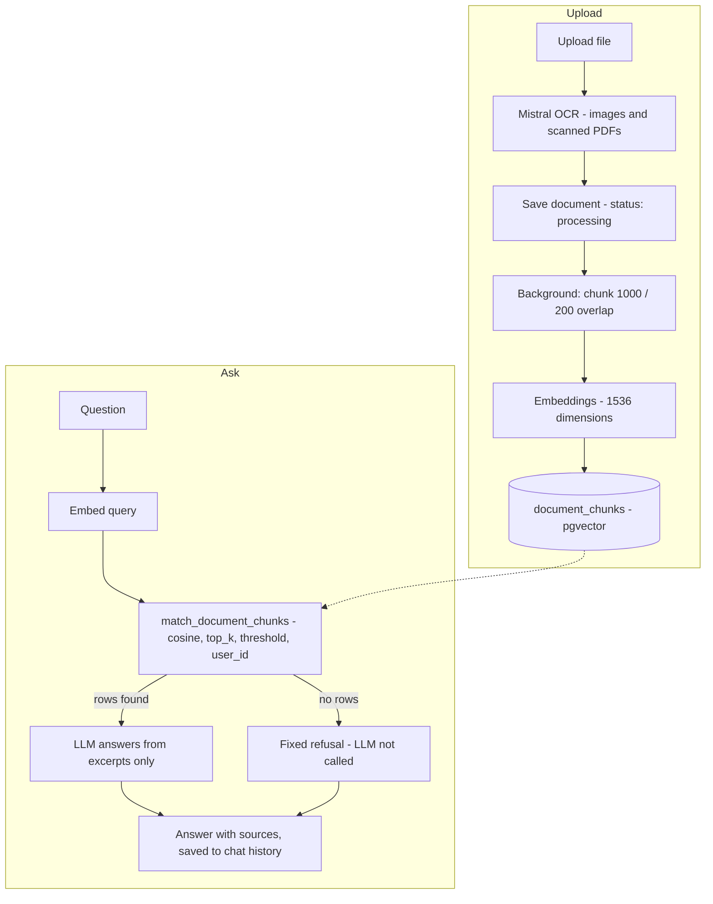

# FinMentor

**A private personal-finance Q&A agent that answers only from your own documents.**

Log in, upload your statements (PDF, images, or text), and ask questions in a chat. FinMentor retrieves the relevant chunks from your private vault and answers from them. If nothing in the vault is similar enough, it refuses instead of guessing.

[Live Demo](https://finmentor-2-ru43.onrender.com/) | [Full Documentation](docs/DOCUMENTATION.md)

---

## Why FinMentor

Money facts live in PDFs and photos: bank statements, Form 16, insurance policies, loans. Generic chatbots either do not have your file and invent a number, or mix their training knowledge with the document, so a salary or coverage figure can be wrong with no warning.

FinMentor's job is narrower:

```
retrieve your text -> answer from it, or say it does not know
```

## Key Features

- **Hallucination gate:** a hard similarity threshold (default 0.75) is checked before any LLM call; weak retrieval returns a fixed refusal and the model is never invoked
- **Private vault per user:** documents, chunks, and chats are scoped to the logged-in account, and `user_id` always comes from the JWT
- **19 document types plus Custom:** bank and credit card statements, Form 16, insurance, loans, and more
- **OCR for images and scanned PDFs** using Mistral
- **Source transparency:** every answer lists the files and similarity scores that grounded it
- **Chat history and voice input** (on browsers that support the Web Speech API)
- **Configurable providers** for LLM and embeddings: OpenAI, Gemini, or Anthropic
- **Demo mode** that runs the full UI without a live Supabase project or paid keys

## Architecture

### Ingestion and query flow



### Components

| Component | Responsibility |
|---|---|
| **FastAPI backend** | Auth wiring, upload, query, vault, and conversation endpoints; also serves the static UI |
| **OCR pipeline** | Extracts text from images and scanned PDFs |
| **Chunking and embeddings** | Splits text with `RecursiveCharacterTextSplitter` and embeds chunks (OpenAI, or Gemini truncated to 1536 and L2-normalized) |
| **Retrieval** | `match_document_chunks` RPC with pgvector cosine similarity, filtered by `user_id` |
| **Auth** | Supabase Auth (password, email or phone OTP, refresh, logout) |
| **Chat store** | Persists conversations and messages per user |
| **Static UI** | Dark chat interface with login gate, history drawer, vault drawer, and voice input |

## Tech Stack

| Layer | Technology |
|---|---|
| Language | Python 3.12+ |
| API | FastAPI, Uvicorn |
| RAG | LangChain text splitters, pgvector |
| OCR | Mistral OCR |
| LLM | Gemini, OpenAI, or Anthropic |
| Embeddings | OpenAI or Gemini |
| Database and Auth | Supabase (Postgres + pgvector) |
| Frontend | HTML, CSS, JavaScript |
| Deployment | Render |

## API Overview

| Method | Endpoint | Auth | Description |
|---|---|---|---|
| `POST` | `/auth/signup`, `/auth/login` | No | Email and password |
| `POST` | `/auth/otp`, `/auth/verify` | No | Email or phone OTP |
| `POST` | `/upload` | Bearer | Upload a file with its `document_type` |
| `POST` | `/query` | Bearer | Ask a question; returns `answer`, `sources`, `conversation_id` |
| `GET` | `/documents` | Bearer | List vault documents |
| `GET` | `/conversations` | Bearer | Chat history |

The full endpoint list is in the [documentation](docs/DOCUMENTATION.md).

## Run Locally

### Prerequisites

- Python 3.12+
- Optional: a Supabase project plus OCR, LLM, and embedding API keys. Without them, the app starts in demo mode.

### Steps

**1. Clone the repository**

```bash
git clone https://github.com/Ayush-2308/FinMentor.git
cd FinMentor
```

**2. Create and activate a virtual environment**

```bash
python -m venv .venv
.\.venv\Scripts\activate         # Windows
# source .venv/bin/activate      # macOS / Linux
```

**3. Install dependencies**

```bash
pip install -r finmentor/requirements.txt
```

**4. Configure environment variables**

```bash
copy finmentor\.env.example finmentor\.env      # Windows
# cp finmentor/.env.example finmentor/.env      # macOS / Linux
```

Add your real keys, or leave the example Supabase URL to run in demo mode. See [Environment Variables](#environment-variables).

**5. Set up the database** (skip in demo mode)

Run the SQL files in `finmentor/db/` on your Supabase project.

**6. Start the server** (from the repository root)

```bash
$env:PYTHONPATH = (Get-Location).Path        # Windows PowerShell
# export PYTHONPATH=$(pwd)                   # macOS / Linux
uvicorn finmentor.main:app --reload --host 127.0.0.1 --port 8000
```

**7. Open the app**

- UI: http://127.0.0.1:8000

### Demo Mode

If `SUPABASE_URL` is missing or a placeholder, the app runs with an in-memory store and keyword-based retrieval. No embedding or LLM calls are made.

| | |
|---|---|
| Email | `demo@finmentor.app` |
| Password | `Demo@12345` |

## Environment Variables

| Variable | Description |
|---|---|
| `SUPABASE_URL` | Supabase project URL |
| `SUPABASE_KEY` | Supabase server key |
| `SUPABASE_ANON_KEY` | Supabase anon key (auth) |
| `OCR_API_KEY` | Mistral API key |
| `OCR_ENDPOINT` | OCR endpoint URL |
| `OCR_PROVIDER` | OCR provider name |
| `LLM_API_KEY` | LLM provider key |
| `LLM_PROVIDER` | `gemini`, `openai`, or `anthropic` |
| `EMBEDDING_API_KEY` | Embedding provider key |
| `EMBEDDING_PROVIDER` | `openai` or `gemini` |
| `SIMILARITY_TOP_K` | Chunks retrieved per query (default `5`) |
| `SIMILARITY_THRESHOLD` | Minimum similarity to answer (default `0.75`) |

Missing required keys stop the app at startup instead of serving half-broken answers. Never commit your `.env` file.

## Documentation

For the full pipeline, demo evaluation results, UI behavior, database schema, and known limitations, see [docs/DOCUMENTATION.md](docs/DOCUMENTATION.md).

FinMentor is not financial, legal, or tax advice. Use fake data only in shared environments.

## Author

**Ayush**
GitHub: [@Ayush-2308](https://github.com/Ayush-2308)
